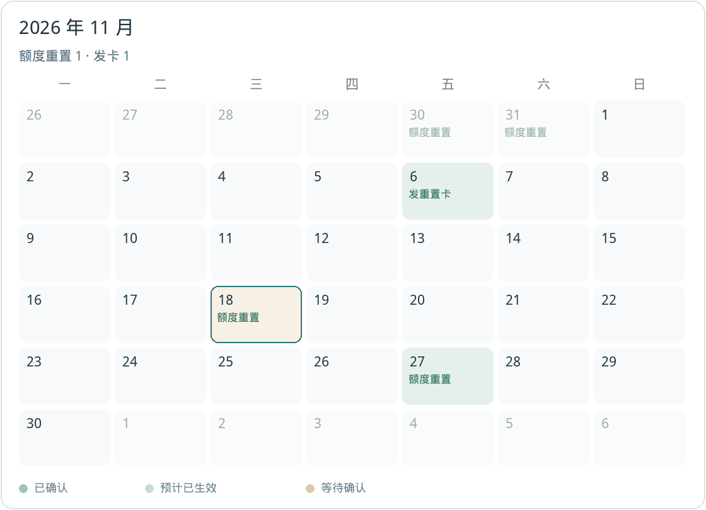
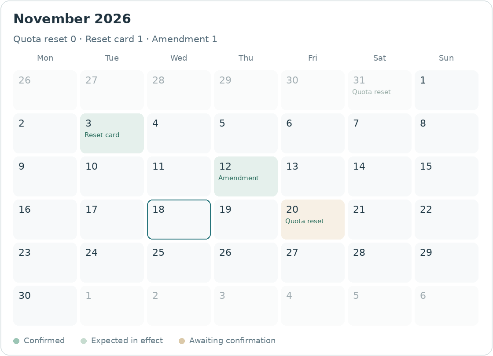

<p align="center">
  
</p>

<h1 align="center">tibo-reset-monitor</h1>

<p align="center">
轮询 AIHOT 公开接口，在 Tibo 发布新的 Codex / ChatGPT 额度重置动态时通知飞书、Telegram 或 Webhook。
</p>

<p align="center">
  <a href="README.en.md">English</a>
</p>

<p align="center">
  <a href="https://github.com/LFenX/tibo_reset_monitor/actions/workflows/ci.yml"></a>
  <a href="https://github.com/LFenX/tibo_reset_monitor/blob/main/.github/workflows/ci.yml"></a>
  <a href="LICENSE"></a>
</p>

Tibo 是 X 上的 [@thsottiaux](https://x.com/thsottiaux)（OpenAI Codex 负责人）。数据来自 [AIHOT](https://aihot.news) 的公开接口 [`/api/v1/codex-resets/recent`](https://aihot.news/api/v1/codex-resets/recent)。确认时间是来源帖子的发布时间，不是账户额度到账的时刻。接口条款见 [aihot.news/terms](https://aihot.news/terms)。

## 目录

- [特性](#特性)
- [效果预览](#效果预览)
- [快速开始](#快速开始)
- [命令](#命令)
- [配置](#配置)
- [渠道](#渠道)
- [Docker 与后台运行](#docker-与后台运行)
- [工作原理](#工作原理)
- [常见问题](#常见问题)
- [开发与测试](#开发与测试)
- [贡献](#贡献)
- [许可证](#许可证)

## 特性

- 默认每 10 分钟拉取最近 7 天的重置动态，使用 `ETag` / `If-None-Match` 和 gzip。
- 第一次成功拉取只建立基线，不推送历史。之后每条新的来源帖（帖子 id + 阶段）才通知。
- 阶段包括预告、确认、补充、撤回。同一条帖子若同时出现在事件列表和活动流里，只通知一次。
- 飞书、Telegram、Webhook 可同时启用。每个渠道都能混合配置群聊（`group`）和个人（`personal`）目标。
- Telegram 每个目标只发一条消息：说明文字在 caption 里，日历图在下面。没有日历图时退回一条纯文本。
- 一个目标失败不会挡住其他目标，也不会让已经成功的目标重发。
- 状态在本地 SQLite。密钥只从环境变量读取。

## 效果预览

Telegram 的一条 `sendPhoto` 说明文字大致如下。日历图接在最后一行「重置日历」下面。没有 Pillow 或中文字体时，同一段文字改用 `sendMessage` 发出，没有第二张图片。

```html
<b>Tibo</b>
<i>@thsottiaux · X</i>

<code>重置（形式未明确，默认额度重置）</code> <code>预告</code>

搞定了。明天见，会有好消息。

<i>帖子未明确适用范围</i>
<i>帖子发布 · 2026-10-28 14:29:38（北京时间）</i>

<blockquote>原帖 · Tibo @thsottiaux
And it's done. See you tomorrow for some good news.
引用 @thsottiaux
Lands by midnight PST.
2026-10-28 14:29:38 · 北京时间</blockquote>
<a href="https://x.com/thsottiaux/status/123">查看原帖</a>

重置日历 · 2026 年 10 月
```

标签原文是「重置（形式未明确）」时，显示为「重置（形式未明确，默认额度重置）」。「重置（额度重置）」「发重置卡」等其他标签保持原样。原帖英文来自 `fullOriginalText`（没有则用 `originalText`）。`context` 里 `relation` 为 `quote` 的写成「引用 @作者」，`reply` 写成「回复 @作者」。引用帖没有单独的发布时间，时间用主帖的 `publishedAt`。没有原文也没有 `context` 时，引用块省略。

`language` 为 `en` 时，同一条通知改用英文。正文是帖子原文，不再放中文翻译，也不再放「原帖」引用块。如果帖子引用了另一条，正文下面留一行 `Quoting @handle: …`（回复则是 `Replying to @handle: …`）。链接写成 View original post。

```html
<b>Tibo</b>
<i>@thsottiaux · X</i>

<code>Reset (form unspecified, defaults to quota reset)</code> <code>Preview</code>

And it's done. See you tomorrow for some good news.

<i>Scope not specified in the post</i>
<i>Posted · 2026-10-28 14:29:38 (Beijing time)</i>

Quoting @thsottiaux: Lands by midnight PST.
<a href="https://x.com/thsottiaux/status/123">View original post</a>

Reset calendar · October 2026
```

日历按北京时间取当前月。格子里 `reset_credit` 写成「发重置卡」，其余写成「额度重置」。形式不明确、且引用了其他事件「补充说明」的，仍标成「补充确认」。顶部数字只统计这个月已确认的事件。月初月末的灰色格子是相邻月份。下面是 2026 年 11 月的样图（6 行周）；12 月和 2027 年 2 月的样图也在 `docs/` 里。

<p align="center">
  
</p>

| 样图 | 周数 |
| --- | --- |
| [2026 年 11 月](docs/calendar-sample-2026-11.png) | 6 行 |
| [2026 年 12 月](docs/calendar-sample-2026-12.png) | 5 行 |
| [2027 年 2 月](docs/calendar-sample-2027-02.png) | 4 行，非闰年 |
| [November 2026，英文](docs/calendar-sample-en-2026-11.png) | 6 行 |
| [December 2026，英文](docs/calendar-sample-en-2026-12.png) | 5 行 |
| [February 2027，英文](docs/calendar-sample-en-2027-02.png) | 4 行，非闰年 |

这些图用假数据绘制，不是某一次真实推送的截图。英文图不依赖中文字体，用 DejaVu、Liberation、Arial 或 Noto Sans。

<p align="center">
  
</p>

## 快速开始

需要 Python 3.10 或更高版本。核心和三个渠道只使用标准库。日历图片需要可选依赖：

```bash
python -m venv .venv
source .venv/bin/activate
pip install -e '.[calendar]'
```

不需要日历图时，`pip install -e .` 即可。Telegram 会改发一条纯文本，并在日志里写一条警告。

```bash
cp config.example.json config.json
cp .env.example .env
```

编辑 `config.json` 里的占位 `receive_id` 和 `chat_id`。密钥放在环境变量里，不要写进配置文件：

```bash
export TIBO_FEISHU_APP_SECRET='你的飞书 App Secret'
export TIBO_TELEGRAM_BOT_TOKEN='你的 Telegram bot token'
```

第一次运行会建立基线，不会把历史帖子推出去：

```bash
tibo-reset-monitor poll --config config.json
tibo-reset-monitor status --config config.json
```

不安装包也可以：

```bash
PYTHONPATH=src python -m tibo_reset_monitor poll --config config.json
```

`config.example.json` 和 `.env.example` 里的 app id、chat id、token 都是占位符。`config.json` 和 `.env` 已在 `.gitignore` 里。

## 命令

全局参数：`--config`（默认 `config.json`）、`--log-level`、`--version`。

| 命令 | 作用 |
| --- | --- |
| `poll` | 拉取一次、入队新帖、投递到期的 outbox。适合 cron、systemd timer、Windows 任务计划程序 |
| `run` | 按 `poll_interval_seconds` 循环。默认 600 秒 |
| `status` | 基线、最近快照、outbox 计数。`--json` 输出 JSON |
| `list` | 已发现的通知和每个目标的投递状态。`--limit` 默认 20，可加 `--json` |
| `send-test --channel telegram --target example-person` | 给一个目标发测试消息，不代表发生了重置 |
| `manual --channel feishu --target example-group --event 3` | 用新的幂等键重发 `list` 里的一条通知 |
| `manual --text "自定义" --channel telegram --target example-person` | 发送自定义文本。标题显示为「手动提醒」 |
| `manual ... --preview` | 只打印将要发送的内容 |

`poll` 在配置错误时退出码为 2，源站拉取失败时为 1。某个目标投递失败仍返回 0，因为失败已写入 outbox，下一轮会重试。

## 配置

配置文件是 JSON。Python 3.10 的标准库没有 `tomllib`，所以这里不用 TOML。

完整字段见 [`config.example.json`](config.example.json)。

| 字段 | 含义 |
| --- | --- |
| `source.url` | 默认 `https://aihot.news/api/v1/codex-resets/recent`，必须是 https |
| `source.history_url` | 可选。默认由 recent 地址去掉 `/recent`，即全量快照 `/api/v1/codex-resets` |
| `source.poll_interval_seconds` | `run` 的间隔。默认 600，最小 60 |
| `source.timeout_seconds` | HTTP 超时。默认 20，范围 1–120 |
| `state.path` | SQLite 路径。环境变量 `TIBO_STATE_PATH` 优先于配置 |
| `logging.level` | `DEBUG`、`INFO`、`WARNING` 或 `ERROR` |
| `logging.file` | 可选日志文件。控制台始终会输出 |
| `calendar.font_path` | 可选。中文字体路径。留空则自动查找 |
| `calendar.font_bold_path` | 可选粗体字体。没有则用常规字体 |
| `calendar.font_index` | 可选。Noto / 思源 CJK 合集默认用 index 2（简体） |
| `calendar.history_refresh_seconds` | 全量历史的刷新间隔。默认 21600（6 小时），最小 600 |
| `language` | 全局默认语言，`zh` 或 `en`。省略时是 `zh` |
| `channels.<name>.language` | 该渠道的默认语言，覆盖全局。飞书、Telegram、Webhook 用同一套语义 |
| `channels.<name>.targets[].language` | 单个目标的语言，覆盖渠道和全局 |
| `channels.<name>.enabled` | `false` 的渠道不会发送 |
| `channels.<name>.targets[]` | `name` 加 `kind`：`group` 或 `personal` |

密钥只写环境变量名，例如 `app_secret_env`、`bot_token_env`、`url_env`。配置里出现 `app_secret`、`bot_token` 这类字段会被拒绝。

`language` 只能是 `zh` 或 `en`。写在根上、渠道上或某个 target 上都可以，后者覆盖前者。三个渠道读的是同一套结果：目标自己的值，否则渠道的值，否则全局，否则 `zh`。非法值会在启动时报出字段路径，例如 `$.channels.telegram.targets[0].language must be "zh" or "en"`。

`zh` 保持现在的中文。`en` 用帖子原文（`fullOriginalText`，没有则 `originalText`），阶段、标签、适用范围、时间和日历都换成英文，并且不展示「原帖」卡片。引用或回复只留一行 `Quoting @handle: …` / `Replying to @handle: …`。

## 渠道

三个渠道可以同时打开。后来才加进配置的目标，只接收加入之后新发现的事件，不补发历史。

### Telegram

1. 在 [@BotFather](https://t.me/BotFather) 发送 `/newbot`，把 token 放进 `TIBO_TELEGRAM_BOT_TOKEN`。
2. 个人目标：用户先打开机器人并按下 Start，否则会收到 403。然后用环境变量里的 token 查看 chat id，不要把 token 贴进聊天或日志：

   ```bash
   curl -s "https://api.telegram.org/bot${TIBO_TELEGRAM_BOT_TOKEN}/getUpdates"
   ```

   `message.chat.id` 是正整数，`kind` 用 `personal`。
3. 群或频道：把机器人加进去，在它能看到的消息里读到负数 chat id（超级群经常以 `-100` 开头）。公开频道也可以写 `@channelusername`。`kind` 用 `group`。
4. 查到 id 之后可以重新打开隐私模式。只发通知不需要机器人一直读群消息。

每个目标一条消息。画得出日历时用 `sendPhoto`，说明在图片上方；否则一条 `sendMessage`。图片说明解析后最多 1024 个字符，纯文本最多 4096。超长时先截断主正文和原帖预览，标签、时间和链接保留。不发送头像，因为这张图片用来放日历。

403（被拉黑或不能发言）和 400 `chat not found` 记为永久失败。429 按 `retry_after` 退避。

### 飞书

本仓库的飞书渠道发送一张交互卡片（Card JSON 2.0），直接调用飞书 Open API，不依赖 `lark-cli`。幂等键放在发送接口的 `uuid` 字段。默认中文卡片的标题、正文和「查看原帖」按钮与以前相同。`en` 时标题、正文和按钮改为英文，正文用帖子原文，不放原帖卡片。画得出日历时，会先把 PNG 上传到飞书，再把图片附在卡片按钮后面；上传失败只记一条警告，文字卡片照常发送。这需要应用具备上传图片的权限（`im:resource`）。没有 Pillow 或对应字体时，卡片里没有图片。

1. 在 [飞书开放平台](https://open.feishu.cn/app) 创建企业自建应用。国际版 Lark 把 `api_base` 改成 `https://open.larksuite.com`。
2. 启用机器人，开通「以应用的身份发消息」（`im:message:send_as_bot`）。用邮箱作为个人目标时，应用还要能按邮箱识别租户内用户。
3. 发布版本。App ID 写入 `app_id`（或 `app_id_env`）。App Secret 放进 `TIBO_FEISHU_APP_SECRET`。
4. 群：把机器人拉进群。`receive_id_type` 必须是 `chat_id`，id 一般以 `oc_` 开头。可用 tenant token 调用 `GET /open-apis/im/v1/chats` 查看机器人所在的群。
5. 个人：`receive_id_type` 为 `open_id`、`user_id` 或 `email` 之一。

### Webhook

可选。`enabled` 默认为 false。每个目标的 URL 来自 `url_env` 指向的环境变量，必须是 https。请求是 JSON，并带 `Idempotency-Key`。正文包含 `idempotency_key`、目标的 `name` / `kind`，以及原来的 `notice` 对象（`stage`、`url`、`published_at`、`text` 等原始字段保持不变）。另外增加按语言填写的 `language`、`title`、`tags`、`scope`、`text`。2xx 视为成功，429 和 5xx 会重试，其他 4xx 记为永久失败。

## Docker 与后台运行

镜像基于 Python 3.12，并安装了 Pillow、文泉驿微米黑和 DejaVu Sans。中文日历用中文字体，英文日历用 DejaVu。状态库在 `/data`。

```bash
docker build -t tibo-reset-monitor .
docker run --rm \
  -v "$PWD/config.json:/config/config.json:ro" \
  -v tibo-state:/data \
  --env-file .env \
  tibo-reset-monitor
```

默认命令是 `run --config /config/config.json`。

### Linux / macOS cron

```cron
*/10 * * * * cd /opt/tibo-reset-monitor && . .venv/bin/activate && set -a && . ./.env && set +a && python -m tibo_reset_monitor poll --config /opt/tibo-reset-monitor/config.json
```

### systemd

示例单元在 [`deploy/systemd/`](deploy/systemd/)。service 执行一次 `poll`，timer 每 10 分钟触发：

```bash
sudo cp deploy/systemd/tibo-reset-monitor.service deploy/systemd/tibo-reset-monitor.timer /etc/systemd/system/
sudo systemctl daemon-reload
sudo systemctl enable --now tibo-reset-monitor.timer
```

也可以把 `ExecStart` 改成 `run` 做常驻进程。不要同时跑 timer 和常驻进程。

### Windows 任务计划程序

```bat
schtasks /Create /TN TiboResetMonitor /SC MINUTE /MO 10 /TR "py -m tibo_reset_monitor poll --config C:\tibo-reset-monitor\config.json"
```

在任务环境里设置密钥，并把起始目录设为项目目录，这样相对的 `state/` 路径才稳定。

## 工作原理

1. `poll` 或 `run` 请求 recent 接口。请求带上次的 `ETag`。响应是 `304` 时不改本地快照。
2. 第一次成功响应只把当前帖子记入基线，不产生通知。
3. 之后按（帖子 id，阶段）去重。阶段来自帖子的 `stage` 和活动的 `action`（`announce`、`confirm`、`amend`、`withdraw`）。`kind` 为 `related` 的闲聊，以及 `outage` 提示，不发通知。
4. 每个（通知，目标）在 SQLite outbox 里有一行、一个幂等键和自己的重试状态。飞书把这个键放进 `uuid`。Telegram 没有对应字段，由 outbox 保证成功后不重发。
5. 明确失败会退避重试。超时这类结果不确定的发送沿用同一个幂等键；距第一次不确定结果约 55 分钟后改为 `needs_review`，不再自动重试。确认对方没收到时，用 `manual --event` 重发。
6. 事件被撤回时，还没发出去的投递会取消。已经发出的保留，撤回本身仍会通知。
7. 拉取失败、限流或响应无法解析时，不覆盖上一份有效快照。
8. 日历用全量接口 `/api/v1/codex-resets` 叠加上 recent。默认每 6 小时最多拉一次，北京时间换月后也会再拉，但两次尝试至少间隔 10 分钟。这次拉取失败不会挡住通知，也不会清掉已有缓存。

请只运行一个 `poll` 或 `run`。状态库里有一把短锁，用来跳过重叠的 cron。

## 常见问题

**为什么启动后没有把过去一周都推送出来？**  
第一次成功拉取是基线。这是故意的，避免把历史刷进群里。

**新加了一个个人目标，为什么没有补发？**  
目标只接收它出现在配置之后新发现的事件。旧通知用 `manual --event` 重发。

**群里收到了，私聊没有。**  
看 `list`。Telegram 个人聊天要先按 Start。飞书机器人要在群里，个人 id 的类型要和 `receive_id_type` 一致。一个目标失败不会取消其他目标。

**`needs_review` 是什么？**  
发送超时后无法确定对方是否已经收下。程序会用同一个幂等键再试一段时间，大约 55 分钟后停止，避免越过飞书大约 1 小时的去重窗口后又发出一条。确认没收到再用 `manual`。

**确认时间是到账时间吗？**  
不是。展示的时间是来源帖子的发布时间。账户里额度何时出现，以产品内显示为准。

**没有日历图。**  
安装 `pip install -e '.[calendar]'`。中文图需要中文字体，或在 `calendar.font_path` 里指定。英文图使用常见的 Latin 字体（DejaVu、Liberation、Arial、Noto Sans），没有中文字体也能画。没装 Pillow，或两种字体都找不到时，Telegram 仍会发出一条纯文本，飞书卡片也不附图片。

## 开发与测试

```bash
PYTHONPATH=src python -m unittest discover -s tests -v
```

GitHub Actions 在 Python 3.10、3.11、3.12、3.13 上各跑两遍：一遍不安装 Pillow，一遍安装 Pillow、文泉驿微米黑和 DejaVu Sans。测试使用假的 HTTP，不访问飞书或 Telegram。已注册的渠道都会在 `zh` 和 `en` 下渲染一次，新渠道漏掉语言时 CI 会失败。

新增渠道见 [docs/adding-a-channel.md](docs/adding-a-channel.md)。`src/tibo_reset_monitor/core/` 不导入任何渠道。

## 贡献

问题、想法和修改欢迎提交到 [GitHub 仓库](https://github.com/LFenX/tibo_reset_monitor)。更短的约定写在 [CONTRIBUTING.md](CONTRIBUTING.md)：保持 Python 3.10 兼容，不要提交密钥或真实 chat id，核心在没有 Pillow 时也要能导入。

## 许可证

[MIT License](LICENSE)。Copyright (c) 2026 LFenX。
